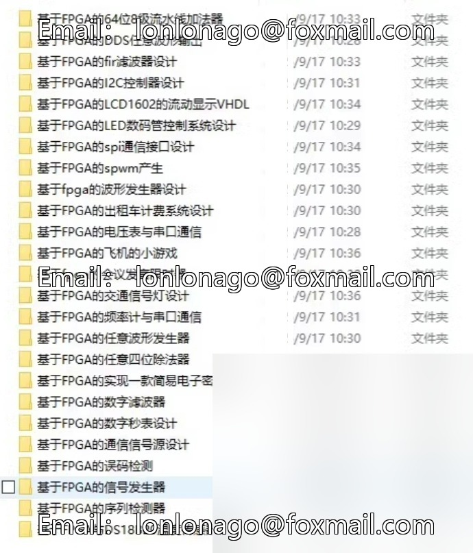

# FPGA project instance source code data , FPGA project development verilog

## Body

FPGA project instance source code collection, FPGA project development verilog VHDL project tutorial altera

Based on FPGA 64-bit 8-stage pipelined adder
Based on FPGA DDS arbitrary waveform output
Based on FPGA fir filter design
Based on FPGA I2C controller design
Based on FPGA LCD1602 flowing display VHDL based on FPGA LED digital tube control system design
Based on FPGA SPI communication interface design
Based on FPGA spwm generation
Based on fpga wave generator design
Based on FPGA taxi billing system design
Based on FPGA voltage meter and I2C communication
Based on FPGA aircraft small game
Based on fpga meeting speech time-limited controller
Based on FPGA traffic signal light design
Based on FPGA frequency meter and serial communication

Based on FPGA arbitrary waveform generator
Based on FPGA arbitrary four-bit divider
Based on FPGA implementation of a simple electronic password lock
Based on FPGA digital filter
Based on FPGA digital stopwatch design
Based on FPGA communication signal source design
Based on FPGA error code detection
Based on FPGA signal generator
Based on FPGA sequence detector
Based on FPGA and DS18B20 temperature sensor communication

online trading, and direct ordering allows immediate shipping.
I am online at long-term and will ship immediately.

The collection of FPGA project source materials covers various FPGA development tasks, including various designs based on FPGA, along with verilog, VHDL tutorials and related materials.

<!-- AI_ENRICHED -->

## Images

## Payment

Here is a pay link on Stripe ( https://buy.stripe.com/3cs8yP7sY87d0vu9AB ). Please contact me lonlonago@foxmail.com after funding $89, and I will send you a complete data files , thank you!

